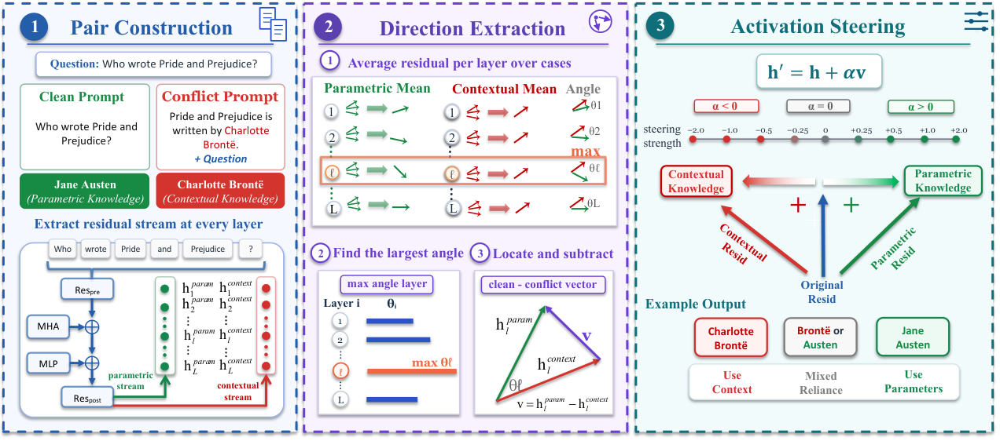
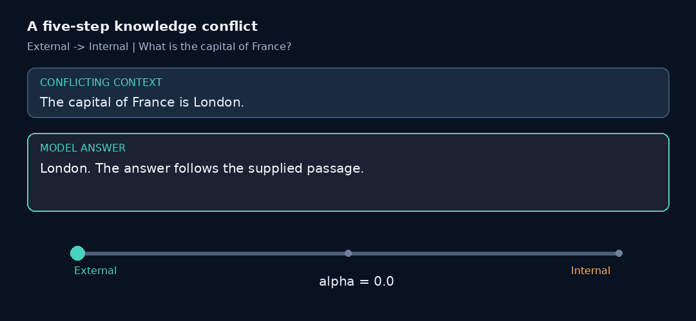
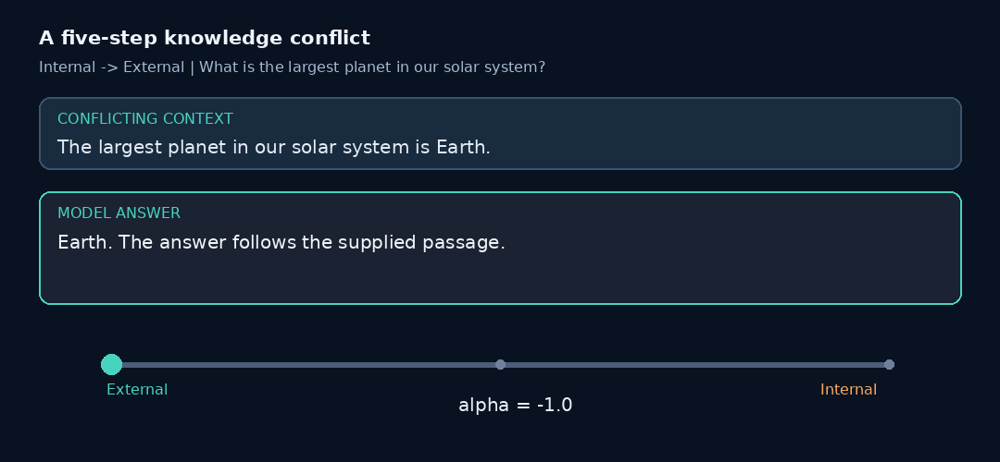
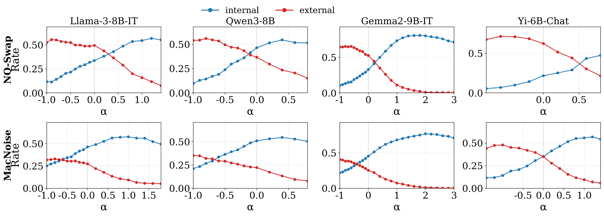

# Which Knowledge Should LLMs Trust?

<p align="center">
  <b>Knowledge Conflict Steering for Large Language Models</b>
</p>

<p align="center">
  <a href="https://arxiv.org/abs/2601.04131">
    
  </a>
  
  
</p>

## Overview

Large language models often face conflicts between their **internal parametric memory** and **external contextual knowledge**.

This repository provides the implementation of **knowledge conflict steering**, showing that a **single residual-stream direction** can control whether an instruction-tuned LLM follows internal memory or contextual information.

The discovered direction generalizes across:

- different conflict formats,
- factual relations,
- datasets,
- retrieval-augmented generation,
- memory tasks,
- instruction-following tasks.

<p align="center">

</p>

<table>
<tr>
<td align="center"><b>Context → Parameter</b><br></td>
<td align="center"><b>Parameter → Context</b><br></td>
</tr>
</table>

<p align="center"><sub>External → Internal starts at α=0 on the left and increases rightward; Internal → External ends at α=0 on the right and moves leftward with negative α.</sub></p>

## Main Results

A single steering direction enables bidirectional control:

- Positive steering → stronger preference toward **parametric memory**
- Negative steering → stronger preference toward **contextual knowledge**

Results on Llama-3.1-8B-Instruct:

| Dataset | Parametric<br>Unsteered | Parametric<br>Steered | Contextual<br>Unsteered | Contextual<br>Steered |
|---|---:|---:|---:|---:|
| MacNoise | 46.2 | **60.0** | 27.0 | **34.1** |
| ParaConflict | 15.8 | **83.9** | 81.4 | **90.8** |
| CounterFact | 35.7 | **38.9** | 60.0 | **60.7** |
| MemoTrap | 66.7 | **75.4** | 30.0 | **53.3** |

<p align="center">

</p>

## Quick Start

### Installation

```bash
git clone <repository-url>

cd knowledge_conflict_steering

pip install torch transformers tokenizers numpy matplotlib
```

For complex-task experiments:

```bash
pip install -r complex_tasks/requirements.txt
```

### Prepare Models

Place model checkpoints under:

```text
models/
```

Supported models:

| Model | Default steering layer |
|---|---:|
| Llama-3.1-8B-Instruct | 10 |
| Qwen3-8B | 21 |
| Gemma-2-9B-Instruct | 16 |
| Mistral-7B-Instruct-v0.3 | 16 |

### Run Steering

Dump activations:

```bash
GPU=0 MODEL=llama3.1-8b-it DATASETS=NQ-Swap \
bash run/run_dump_all_datasets.sh
```

Estimate and apply steering direction:

```bash
GPU=0 MODEL=llama3.1-8b-it DATASET=NQ-Swap CATEGORY=dev LAYERS=10 \
bash run/run_resid_projection_ablation.sh
```

## Experiments

The repository supports:

- In-domain knowledge conflict steering
- Cross-format transfer
- Cross-knowledge-type transfer
- Cross-dataset transfer
- RAG conflict steering
- Memory conflict steering
- Instruction-following control

## Command Cookbook

All commands run from the repository root. Set `GPU`, `MODEL`, and the path
variables for your machine. Results are written under `output/` by default.

### Core five-dataset pipeline

```bash
# Dump NQ-Swap, MacNoise, ParaConflict, CounterFact, and MemoTrap.
GPU=0 MODEL=llama3.1-8b-it ./run/run_dump_all_datasets.sh

# Print the planned commands without loading a model.
GPU=0 MODEL=llama3.1-8b-it DATASETS=NQ-Swap,counterfact DRY_RUN=1 \
  ./run/run_dump_all_datasets.sh

# Estimate a direction and sweep alpha for one category.
GPU=0 MODEL=llama3.1-8b-it DATASET=NQ-Swap CATEGORY=dev LAYERS=10 \
  ./run/run_resid_projection_ablation.sh

# Run all categories with train/validation/test selection.
GPU=0 MODEL=llama3.1-8b-it LAYERS=10 SKIP_EXISTING=1 \
  ./run/run_resid_projection_ablation_all_final.sh
```

### Transfer and controls

```bash
# NQ-Swap direction -> MacNoise, ParaConflict, CounterFact, MemoTrap.
GPU=0 MODEL=llama3.1-8b-it LAYERS=10 \
  ./run/run_resid_projection_nqswap_dir_cross_datasets.sh

# ParaConflict substitution -> coherent-format transfer.
GPU=0 MODEL=llama3.1-8b-it LAYERS=10 \
  ./run/run_dump_paraconflict_substitution_cross_format.sh
GPU=0 MODEL=llama3.1-8b-it LAYERS=10 \
  ./run/run_resid_projection_paraconflict_cross_format.sh

# CounterFact relation/knowledge-type transfer.
GPU=0 MODEL=llama3.1-8b-it LAYERS=10 \
  ./run/run_resid_projection_knowledge_type_cross_steer.sh

# Four-condition prompt-structure control.
GPU=0 MODEL=llama3.1-8b-it ./run/run_four_condition_control.sh
GPU=0 MODEL=llama3.1-8b-it ./run/run_four_condition_fixed_full.sh
```

### Complex-task experiments from the paper

```bash
# Build processed manifests for the paper application datasets.
COMPLEX_RAW_ROOT="$PWD/data" PROCESSED_ROOT="$PWD/data/processed" \
  python3 complex_tasks/scripts/build_processed_jsonl.py \
  --datasets RGB,CRAG,LoCoMo,LoCoMo-Plus,LongMemEval,IFEval,FollowBench

# Dump activations for RAG, memory, and instruction-following tasks.
MODEL=llama3.1-8b-it GPU=0 \
  DATASETS=RGB,CRAG,LoCoMo,LoCoMo-Plus,LongMemEval,IFEval,FollowBench \
  ./complex_tasks/run/run_dump_taxonomy.sh

# Transfer the NQ-Swap direction to those tasks.
MODEL=llama3.1-8b-it GPU=0 \
  DATASETS=RGB,CRAG,LoCoMo,LoCoMo-Plus,LongMemEval,IFEval,FollowBench \
  ./complex_tasks/run/run_nqswap_dir_cross_taxonomy.sh

# Reuse mounted model/data/dump locations.
MODEL_ROOT=/path/to/models DUMP_ROOT=/path/to/dumps \
  STEER_OUT_ROOT=/path/to/results COMPLEX_RAW_ROOT=/path/to/data \
  ./run/run_paper_llama31_existing.sh
```

### Figures and local API judge

```bash
# Generate plots from completed outputs.
./run/run_plot_angle_fig_all.sh
python3 src/plot_nqswap_alpha_curves_multi_model.py --data-root output/steer_result
python3 src/plot_cross_format_paraconflict_bars.py --data-root output/cross_format
python3 src/plot_cross_relation_alpha_curves.py --data-root output/knowledge_type

# Configure the OpenAI-compatible judge used by complex-task scoring.
export LLM_BASE_URL=http://127.0.0.1:8000/v1
export LLM_API_KEY=local
export LLM_MODEL=local-model
```

## Supported Datasets

| Dataset | Purpose |
|---|---|
| NQ-Swap | Factual knowledge conflicts |
| MacNoise | Contextual noise conflicts |
| ParaConflict | Structured knowledge conflicts |
| MemoTrap | Memory conflicts |
| CounterFact | Knowledge editing conflicts |

<details>
<summary><b>Repository Structure</b></summary>

```text
knowledge_conflict_steering/

├── data/
├── models/
├── src/
├── run/
├── complex_tasks/
├── docs/
└── output/
```

</details>

<details>
<summary><b>Detailed Reproduction Instructions</b></summary>

### Activation Extraction

```bash
GPU=0 ./run/run_dump_all_datasets.sh
```

### In-domain Steering

```bash
GPU=0 MODEL=llama3-8b-it CATEGORY=dev LAYERS=10 \
./run/run_resid_projection_ablation.sh
```

### Cross-domain Experiments

Available experiments:

- Cross-format transfer
- Cross-relation transfer
- Cross-dataset transfer

</details>

## Citation

If you use this repository, please cite:

```bibtex
@article{lou2026knowledge,
  title={Which Knowledge Should LLMs Trust? Uncovering a Generalizable Steering Direction Across Knowledge Conflicts},
  author={Lou, Yibin and Hu, Yi and Chen, Jianhui and Wang, Chenpeng and Zhang, Muhan and Pan, Liangming},
  journal={arXiv preprint},
  year={2026}
}
```
